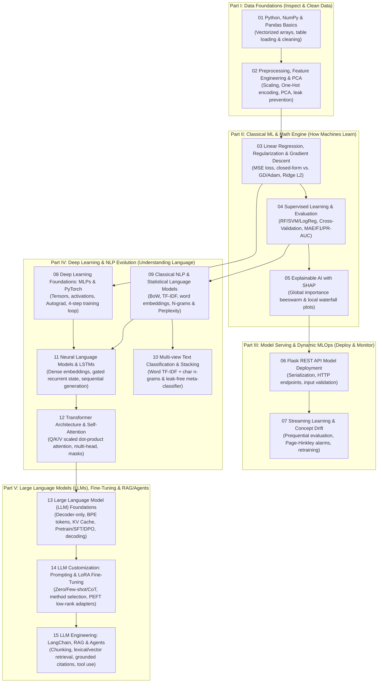

**Language:** English | [简体中文](STUDY_ROADMAP.zh-CN.md) · [Home](README.md)

# AI Knowledge Base | Beginner's Master Roadmap & Knowledge Architecture (5 Parts · 15 Chapters)

Synthesizing best practices from top-rated open-source AI curricula on GitHub (Microsoft, Datawhale, Dive into Deep Learning / D2L, Karpathy's `nn-zero-to-hero`, Maxime Labonne's `llm-course`, and Goku Mohandas's `Made-With-ML`), this knowledge base organizes all study notes in **strictly progressive order from `01` to `15`** across **Five Cohesive Parts**—taking you step by step from raw data cleaning to modern Large Language Model (LLM) engineering.

Every chapter directly answers: ***"What limitation did the previous step leave unresolved? What problem does this new concept solve? And what is its real-world intuition?"***

---

## 1. The Big Picture: Five Progressive Parts

1. **Part I: Data Foundations (`01 → 02` | Sourcing, Sorting & Prepping Ingredients)**
   - Real-world data arrives with missing values, outliers, and mismatched units.
   - **Purpose**: Load tables and manipulate NumPy matrices & Pandas DataFrames (`01`), then apply scaling, one-hot encoding, and PCA dimensionality reduction inside leak-free pipelines (`02`).
2. **Part II: Classical Machine Learning & Math Engine (`03 → 04 → 05` | Learning Recipes, Mock Exams & X-Ray Audits)**
   - How does a machine mathematically learn patterns from data?
   - **Purpose**: Master the universal optimization engine—**Loss Functions, Gradient Descent, and Regularization** (`03`); build regression and classification pipelines evaluated with Cross-Validation and honest metrics like MAE, F1, and PR-AUC (`04`); and open the black box with **SHAP Explainable AI** (`05`).
3. **Part III: Model Serving & Dynamic MLOps (`06 → 07` | Opening the Service Window & Adapting to Changing Seasons)**
   - Models must be served to live applications and maintained as the outside world evolves.
   - **Purpose**: Serve serialized pipelines over **Flask HTTP REST APIs** (`06`), and detect distribution shifts (**Concept Drift**) with **Page–Hinkley** alarms and online/sliding-window updates (`07`).
4. **Part IV: Deep Learning & NLP Evolution (`08 → 09 → 10 → 11 → 12` | Four Historic Leaps in Reading Human Language)**
   - Trace how AI progressed from tabular classifiers to understanding human language:
   - **Leap 1 (Neural Network Foundation `08`)**: Stack linear layers with non-linear activations (`ReLU`) using PyTorch autograd and the 4-step training loop.
   - **Leap 2 (Word Counts & Multi-View Ensembles `09 → 10`)**: Represent text with Bag-of-Words, TF-IDF, static word embeddings, and statistical N-gram language models scored by Perplexity (`09`), and fuse complementary text views via leak-free **Stacking ensembles** (`10`).
   - **Leap 3 (Learned Embeddings & Recurrent Memory `11`)**: Overcome sparse count tables and preserve word order using dense `nn.Embedding` lookup tables and gated **LSTM** recurrent states for token-by-token generation (`11`).
   - **Leap 4 (The Self-Attention Revolution `12`)**: Replace slow sequential recurrence with parallel **`Q/K/V` Scaled Dot-Product Self-Attention** (`12`)—the architectural heart of modern AI.
5. **Part V: Large Language Models (LLMs), Fine-Tuning & RAG/Agents (`13 → 14 → 15` | From LLM Internals to Production GenAI)**
   - **Chapter 13 (LLM Foundations)**: Understand how Transformer blocks scale into modern LLMs—why **Decoder-only** won, how **BPE subword tokenization** and **KV Cache** work, the **Pre-training → SFT → RLHF/DPO** training lifecycle, **Greedy / Temperature / Top-k / Top-p** decoding, and why LLMs hallucinate.
   - **Chapter 14 (Prompting & LoRA Fine-Tuning)**: Guide LLMs without weight updates via **Zero/Few-shot & Chain-of-Thought prompting**, know when to choose Prompting vs. RAG vs. Fine-Tuning, and adapt model weights cheaply with **PEFT / LoRA** low-rank adapters ($\Delta W = BA$).
   - **Chapter 15 (LangChain, RAG & Agents Capstone)**: Overcome knowledge cutoffs and hallucinations by grounding LLMs in retrieved private documents (**RAG**), and empower models to invoke external APIs safely via **Tool Calling & Agents**.

---

## 2. Five-Part, 15-Chapter Evolutionary Flowchart (`01 → 15`)

---

## 3. Problem-Driven Matrix Across All 15 Chapters

| Chapter & Note Link | Intuitive Analogy | Core Purpose: What Problem Does It Solve? | What Goes Wrong Without It? | Linked Project Folder |
|---|---|---|---|---|
| **[01 Python, NumPy & Pandas](notes/01_python_pandas.md)** | Ingredient Sourcing & High-Speed Slicer | Load messy CSVs, run vectorized NumPy matrix ops (`@`), and profile missing values/outliers. | Feeding `NaN`s, corrupted strings, or extreme outliers straight into algorithms. | [`01_data_foundations`](projects/01_data_foundations/README.md) |
| **[02 Preprocessing & PCA](notes/02_preprocessing_feature_engineering_pca.md)** | Washing, Chopping & Condensing | Normalize feature scales, encode categories (One-Hot), and compress dimensions with PCA. | **Data Leakage**: fitting scalers/PCA on the full dataset before splitting train and test sets. | [`01_data_foundations`](projects/01_data_foundations/README.md) |
| **[03 Regression & Optimization](notes/03_regression_optimization.md)** | Walking Downhill Blindfolded | Reveal the engine of ML: measure error via loss functions, step down gradients (GD/Adam), and regularize weights (Ridge). | Loss exploding to `NaN` from oversized learning rates or slow convergence on unscaled features. | [`09_regression_and_optimization`](projects/09_regression_and_optimization/README.md) |
| **[04 Supervised Learning & Evaluation](notes/04_supervised_learning_evaluation.md)** | Mock Exams vs. Final Exam | Build regression & classification pipelines evaluated with Cross-Validation and proper metrics (MAE, F1, PR-AUC). | Trusting plain Accuracy on imbalanced data (99% normal, 1% fraud) where a dummy classifier scores 99%. | [`02_house_price_regression`](projects/02_house_price_regression/README.md) [`03_classification_and_faces`](projects/03_classification_and_faces/README.md) |
| **[05 Explainable AI (SHAP)](notes/05_explainable_ai_shap.md)** | X-Raying the Black Box | Quantify how much each feature pushed a prediction up or down (Shapley values) globally and locally. | Deploying opaque predictions in high-stakes domains or mistaking model attribution for causality. | [`08_explainable_ai`](projects/08_explainable_ai/README.md) |
| **[06 Flask Model Deployment](notes/06_flask_model_deployment.md)** | Opening the Service Window | Serialize trained pipelines and serve real-time predictions over HTTP REST APIs with input validation. | Retraining on every HTTP request or letting malformed JSON inputs crash the server. | [`04_flask_iris_api`](projects/04_flask_iris_api/README.md) |
| **[07 Streaming Learning & Drift](notes/07_stream_learning_concept_drift.md)** | Updating the Menu When Tastes Change | Detect distribution shifts over time (Page–Hinkley test) and update models via prequential evaluation. | Assuming a static deployed model stays accurate forever as real-world behavior changes. | [`05_concept_drift`](projects/05_concept_drift/README.md) |
| **[08 Neural Networks & PyTorch](notes/08_neural_networks_pytorch.md)** | Building a Multi-Layer Brain with LEGOs | Stack linear layers with non-linear activations (`ReLU`), Autograd, and the 4-step PyTorch training loop. | Forgetting `zero_grad()`, passing softmax probabilities to `CrossEntropyLoss`, or leaking gradients at eval time. | [`10_pytorch_mlp`](projects/10_pytorch_mlp/README.md) |
| **[09 Classical NLP & Statistical LMs](notes/09_classical_nlp_language_models.md)** | Counting Word Frequencies & Dictionaries | Convert text into vectors (BoW, TF-IDF, word embeddings) and evaluate N-gram next-word models with Perplexity (PPL). | Hitting zero-probability division-by-zero on unseen words (OOV) without smoothing, or losing word order. | [`11_classical_nlp`](projects/11_classical_nlp/README.md) |
| **[10 Multi-view Text Stacking](notes/10_multiview_text_classification_stacking.md)** | Panel of Specialists Voting Together | Combine complementary text views (word TF-IDF + char n-grams) via a leak-free Stacking meta-classifier. | Training the meta-classifier on in-sample predictions from the base training split. | [`07_multiview_stacking`](projects/07_multiview_stacking/README.md) |
| **[11 Neural LMs & LSTMs](notes/11_neural_language_models.md)** | Reading Sequential Notes with Memory | Use dense `nn.Embedding` tables and recurrent LSTM states $(h_t, c_t)$ to model word order and generate text. | Feeding prompt tokens repeatedly during generation; hitting sequential training bottlenecks on long texts. | [`12_neural_language_models`](projects/12_neural_language_models/ASSETS.md) |
| **[12 Transformers & Self-Attention](notes/12_transformer_attention.md)** | Open Roundtable Meeting | Replace sequential recurrence with parallel `Q/K/V` scaled dot-product attention, masks, and positional encoding. | Omitting padding masks or forgetting $\sqrt{d_k}$ scaling (causing vanishing softmax gradients). | [`13_transformer_encoder`](projects/13_transformer_encoder/README.md) |
| **[13 LLM Foundations](notes/13_llm_foundations.md)** | Three-Stage Education of a Generalist | Understand **Decoder-only LLMs, BPE tokenization, KV Cache, Pre-training → SFT → RLHF/DPO, and Temperature/Top-p decoding**. | Confusing Base and Instruct models, misconfiguring sampling parameters, or misunderstanding hallucinations. | [`13_transformer_encoder`](projects/13_transformer_encoder/README.md) [`14_llm_prompting_and_lora`](projects/14_llm_prompting_and_lora/README.md) |
| **[14 Prompting & LoRA Fine-Tuning](notes/14_llm_prompting_finetuning_lora.md)** | Communication Skills & Plug-in Adapters | Design Zero/Few-shot/CoT prompts, choose between Prompting/RAG/Fine-Tuning, and train PEFT/LoRA adapters ($\Delta W = BA$). | Using LoRA to memorize daily-changing facts (where RAG belongs) or deploying adapters without their base model. | [`14_llm_prompting_and_lora`](projects/14_llm_prompting_and_lora/README.md) |
| **[15 LangChain, RAG & Agents](notes/15_llm_langchain_rag.md)** | Open-Book Library & Action Toolkit | Ground LLMs in retrieved private documents (RAG) with source citations, and bind external tools via Agents. | Assuming RAG eliminates all hallucinations, or falling victim to indirect Prompt Injection in retrieved texts. | [`06_llm_rag`](projects/06_llm_rag/README.md) |

---

## 4. Three Goal-Oriented Fast Tracks

- **📊 Track A: Data Science & Tabular ML Engineering**: `01 → 02 → 03 → 04 → 05 → 06 → 07`
- **📝 Track B: Deep Learning & NLP Evolution**: `01 → 03 → 08 → 09 → 10 → 11 → 12 → 13`
- **🤖 Track C: Generative AI & LLM Application Engineering**: `01 → 09 → 12 → 13 → 14 → 15`

---

## 5. Curated Top-Rated Open-Source AI Knowledge Bases (External Benchmarks)

| Part in This Repo | Top-Rated Repository / Course | Author / Org | Why It's Great & How to Pair |
|---|---|---|---|
| **Parts I & II** (`01–05`) | **[ML-For-Beginners](https://github.com/microsoft/ML-For-Beginners)** (80k+ ⭐) **[pumpkin-book](https://github.com/datawhalechina/pumpkin-book)** (40k+ ⭐) | Microsoft / Datawhale | Visual sketch notes & beginner quizzes + step-by-step mathematical derivations for classic ML. |
| **Part III** (`06–07`) | **[Made-With-ML](https://github.com/GokuMohandas/Made-With-ML)** (40k+ ⭐) | Goku Mohandas | Industry gold-standard guide on production MLOps: testing, serving, CI/CD, and drift monitoring. |
| **Part IV** (`08–12`) | **[Dive into Deep Learning (D2L)](https://github.com/d2l-ai/d2l-en)** (65k+ ⭐) **[nn-zero-to-hero](https://github.com/karpathy/nn-zero-to-hero)** | Aston Zhang, Mu Li / Andrej Karpathy | Interactive PyTorch textbook + coding backpropagation and GPT from scratch. |
| **Part V (Foundations & LoRA)** (`13–14`) | **[LLMs-from-scratch](https://github.com/rasbt/LLMs-from-scratch)** **[llm-course](https://github.com/mlabonne/llm-course)** & **[self-llm](https://github.com/datawhalechina/self-llm)** | Sebastian Raschka / Maxime Labonne / Datawhale | Code-first GPT architecture + practical guides on quantization, LoRA/QLoRA fine-tuning, and DPO alignment. |
| **Part V (RAG & Agents)** (`15`) | **[generative-ai-for-beginners](https://github.com/microsoft/generative-ai-for-beginners)** (75k+ ⭐) **[llm-universe](https://github.com/datawhalechina/llm-universe)** | Microsoft / Datawhale | 21-lesson GenAI curriculum + hands-on vector-database RAG and Agent tutorials. |
