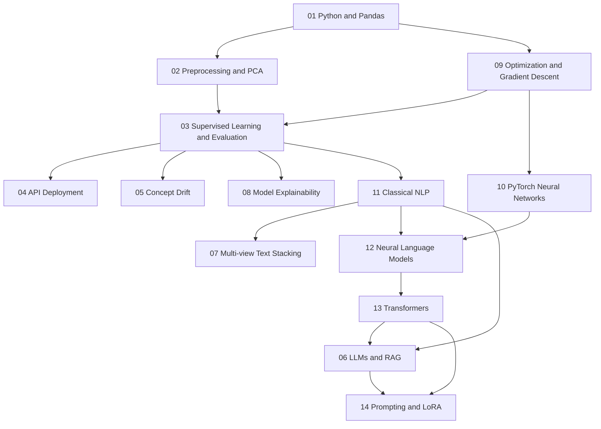

**Language:** English | [简体中文](STUDY_ROADMAP.zh-CN.md)

# AI Knowledge Base | Study Roadmap

Start with the relevant chapter in `notes/`, run the matching script in `projects/`, and finally repeat the workflow on your own authorized dataset.

## Foundation: structured data and supervised learning

| Chapter | Focus | Project |
|---|---|---|
| 01 | Python, NumPy, Pandas, data inspection | `01_data_foundations` |
| 02 | Scaling, encoding, missing values, PCA, pipelines | `01_data_foundations` |
| 09 | Least squares, Ridge, gradient descent | `09_regression_and_optimization` |
| 03 | Regression, classification, CV, MAE/F1 | `02_house_price_regression`, `03_classification_and_faces` |
| 04 | Train → save → serve REST API → predict | `04_flask_iris_api` |
| 05 | Online learning, Page–Hinkley | `05_concept_drift` |
| 08 | Local and global SHAP explanations | `08_explainable_ai` |

## Deep learning and NLP

| Chapter | Focus | Project |
|---|---|---|
| 10 | Autograd, loss functions, optimizers, training loops | `10_pytorch_mlp` |
| 11 | BoW, TF-IDF, embeddings, N-grams | `11_classical_nlp` |
| 07 | Base/meta/test stacking | `07_multiview_stacking` |
| 12 | Neural N-grams, LSTMs, generation | `12_neural_language_models` |
| 13 | Q/K/V, masks, encoder | `13_transformer_encoder` |

## Generative AI and engineering

| Chapter | Focus | Project |
|---|---|---|
| 06 | Prompts, retrieval, RAG, tool use | `06_llm_rag` |
| 14 | Zero-/few-shot prompting, LoRA, PEFT | `14_llm_prompting_and_lora` |

**Three connected learning paths:** structured data (01 → 02 → 09 → 03 → 08 → 04); text analysis (11 → 07 → 10 → 13); generative AI (11 → 12 → 13 → 06 → 14).

Neural N-grams run offline. The LSTM inference example needs compatible vocabulary and weights, documented in [ASSETS.md](projects/12_neural_language_models/ASSETS.md). Small, synthetic datasets illustrate a pipeline; their evaluation metrics are not evidence of performance in production.
