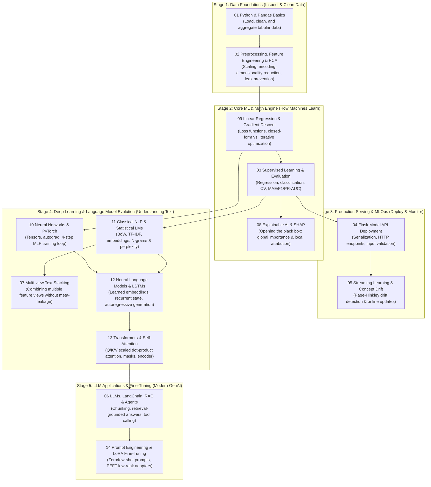

**Language:** English | [简体中文](STUDY_ROADMAP.zh-CN.md) · [Home](README.md)

# AI Knowledge Base | Beginner's Master Roadmap & Knowledge Architecture

If you are new to Artificial Intelligence (AI), reading chapters strictly in numerical order (`01 → 14`) can feel jarring: *"Why do we jump from basic classification (03) straight to LLM RAG (06), only to go back to elementary linear regression and gradient descent in Chapter 09?"*

That is because **the numbers `01–14` are simply module IDs**. To help beginners clearly see **how AI evolved step by step** and **what real-world problem each concept solves**, we synthesized best practices from the highest-rated open-source curricula on GitHub (Microsoft, Datawhale, Dive into Deep Learning / D2L, Made With ML, etc.) and organized all 14 modules into a **5-Stage Progressive Knowledge Architecture**.

---

## 1. The Big Picture: Analogy of "Training and Running an Expert Culinary Kitchen"

Before diving into equations and code, use this mental model to understand what role each of the 14 modules plays in the real world:

1. **Stage 1: Data Foundations (Sourcing & Washing Ingredients | `01 → 02`)**
   - You cannot cook a great meal with spoiled ingredients. Real-world data is full of missing values, type errors, and mismatched scales (e.g., comparing square footage in thousands with bedroom counts in single digits).
   - **Purpose**: Use Python and Pandas to load, inspect, and clean raw tables (`01`), then apply scaling, one-hot encoding, and PCA dimensionality reduction to turn raw data into clean "prep ingredients (features)" (`02`).
2. **Stage 2: Core Machine Learning & Mathematical Engine (Learning Recipes, Taste-Testing & Explaining Dish Choices | `09 → 03 → 08`)**
   - How does a machine actually "learn" patterns from data?
   - **Purpose**: First understand the core trial-and-error engine—**Gradient Descent & Optimization** (`09`, like walking downhill blindfolded to find the lowest valley); next, master the standard workflow for predicting continuous numbers (regression) and categories (classification) with leak-free cross-validation (`03`); finally, use **SHAP Explainable AI** (`08`) to look inside the black box and explain *why* the model made a specific prediction.
3. **Stage 3: Production Engineering & Dynamic Maintenance (Opening the Restaurant & Adapting to Changing Seasons | `04 → 05`)**
   - A model sitting in a local script delivers zero value until real users can query it—and the outside world never stops changing.
   - **Purpose**: Wrap your trained model in a **Flask REST API** so external apps can request predictions over HTTP (`04`); when market conditions or user behaviors shift over time (Concept Drift) and degrade accuracy, use **Page–Hinkley drift detection & online learning** (`05`) to raise alerts and update the model dynamically.
4. **Stage 4: From Classical NLP to Deep Learning & Transformers (From Reading Spreadsheets to Understanding Human Language | `10 → 11 → 07 → 12 → 13`)**
   - Classical ML excels at structured tables, but struggles with complex non-linear patterns and raw human language. This stage traces **the four historic leaps in how machines read text**:
   - **Leap 1 (Neural Network Foundation `10`)**: Stack linear layers with non-linear activations (MLP) using PyTorch autograd to learn complex representations.
   - **Leap 2 (Word Counting & Multi-View Ensembles `11 → 07`)**: Early NLP represented text by counting words/phrases (BoW, TF-IDF, statistical N-grams, `11`) and combined multiple feature views (e.g., body text + metadata) via **Stacking ensembles** (`07`).
   - **Leap 3 (Sequential Memory `12`)**: Counting words loses word order ("dog bites man" vs. "man bites dog"). **Neural N-grams and LSTMs** (`12`) introduced dense word embeddings and recurrent memory states to read and generate text token by token.
   - **Leap 4 (The Self-Attention Revolution `13`)**: LSTMs process words one by one in a single-lane queue and forget long-range context. **Transformers & Self-Attention (`13`)** solved this by letting every word attend directly to every other word in parallel—forming the heart of all modern LLMs (GPT, Claude, Qwen, Llama).
5. **Stage 5: Large Language Model (LLM) Applications & Fine-Tuning (Standing on the Shoulders of Giants | `06 → 14`)**
   - With powerful pre-trained Transformers available, we rarely train language models from scratch. Instead, we adapt them to solve domain-specific problems:
   - **Purpose**: Pre-trained LLMs don't know your private documents and can hallucinate. **Prompt Engineering, RAG (Retrieval-Augmented Generation), and Agent tool use** (`06`) give the LLM an "open-book reference library" and "hands" to call external APIs. When you need to customize a model's style, output format, or domain behavior on a budget, **PEFT / LoRA fine-tuning** (`14`) freezes the base model and trains a tiny low-rank adapter (<1% of parameters).

---

## 2. Five-Stage Progressive Roadmap (Recommended Learning Order)

Start by reading the chapter note in `notes/` for intuition and pitfalls, run the matching project in `projects/`, and then experiment with your own dataset.

---

## 3. Problem-Driven Module Matrix: Why Each Topic Exists

Every chapter exists to solve a concrete limitation of the step before it:

| Recommended Step | Chapter & Note Link | Intuitive Analogy | Core Purpose: What Problem Does It Solve? | What Goes Wrong Without It? | Hands-On Project |
|---|---|---|---|---|---|
| **Step 1** | [01 Python & Pandas](notes/01_python_pandas.md) | Ingredient Sourcing & Sorting | Load messy CSVs into memory, inspect missing values/outliers/types, and compute grouped summaries. | Feeding corrupted strings, NaNs, or extreme outliers straight into a model, causing crashes or garbage outputs. | [`01_data_foundations`](projects/01_data_foundations/README.md) |
| **Step 2** | [02 Preprocessing & PCA](notes/02_preprocessing_feature_engineering_pca.md) | Washing, Chopping & Condensing | Normalize feature scales, encode categories into numbers (One-Hot), and compress redundant columns with PCA. | **Data Leakage**: fitting scalers/imputers on the whole dataset before `train_test_split`, inflating test scores. | [`01_data_foundations`](projects/01_data_foundations/README.md) |
| **Step 3** | [09 Gradient Descent & Optimization](notes/09_regression_optimization.md) | Walking Downhill Blindfolded | Reveal the mathematical engine behind ML: measure prediction error (loss) and iteratively step down the gradient to optimal weights. | Blindly tuning hyperparameters without understanding why loss explodes to `NaN` or why unscaled features slow convergence. | [`09_regression_and_optimization`](projects/09_regression_and_optimization/README.md) |
| **Step 4** | [03 Supervised Learning & Evaluation](notes/03_supervised_learning_evaluation.md) | Mock Exams vs. Final Exam | Build end-to-end regression and classification pipelines evaluated with Cross-Validation (CV) and proper metrics (MAE, F1, PR-AUC). | Relying on plain Accuracy for imbalanced data (e.g., 99% normal, 1% fraud), mistaking a useless "always-normal" predictor for a 99% accurate model. | [`02_house_price_regression`](projects/02_house_price_regression/README.md) [`03_classification_and_faces`](projects/03_classification_and_faces/README.md) |
| **Step 5** | [08 Explainable AI (SHAP)](notes/08_explainable_ai_shap.md) | X-Raying the Black Box | Quantify how much each feature pushed a prediction up or down (Shapley values) at both global and single-sample levels. | Deploying opaque predictions in high-stakes domains (finance, healthcare) without auditing feature attributions or mistaking correlation for causation. | [`08_explainable_ai`](projects/08_explainable_ai/README.md) |
| **Step 6** | [04 Flask Model Deployment](notes/04_flask_model_deployment.md) | Opening the Service Window | Serialize a trained pipeline and expose it via an HTTP REST API with strict input validation and JSON responses. | Retraining the model on every request or failing to validate malformed user inputs before calling `model.predict()`. | [`04_flask_iris_api`](projects/04_flask_iris_api/README.md) |
| **Step 7** | [05 Streaming Learning & Concept Drift](notes/05_stream_learning_concept_drift.md) | Updating the Menu When Tastes Change | Detect when real-world data distributions shift over time (Page–Hinkley test) and trigger sliding-window or incremental updates. | Assuming a deployed model stays accurate forever while changing user behavior silently degrades production performance. | [`05_concept_drift`](projects/05_concept_drift/README.md) |
| **Step 8** | [10 Neural Networks & PyTorch](notes/10_neural_networks_pytorch.md) | Building a Multi-Layer Brain with LEGOs | Move from linear models to Multi-Layer Perceptrons (MLPs), mastering tensors, non-linear activations, autograd, and the 4-step training loop. | Forgetting `optimizer.zero_grad()`, passing softmax probabilities into `CrossEntropyLoss`, or leaking gradients during evaluation. | [`10_pytorch_mlp`](projects/10_pytorch_mlp/README.md) |
| **Step 9** | [11 Classical NLP & Language Models](notes/11_classical_nlp_language_models.md) | Counting Word Frequencies & Dictionaries | Turn raw text into numeric vectors (BoW, TF-IDF, word embeddings) and estimate next-word probabilities with N-grams and Perplexity (PPL). | Hitting zero-probability division-by-zero on unseen words (OOV) without smoothing, or losing word order by averaging word vectors. | [`11_classical_nlp`](projects/11_classical_nlp/README.md) |
| **Step 10** | [07 Multi-view Text Stacking](notes/07_multiview_text_classification_stacking.md) | Panel of Specialists Voting Together | Train separate base classifiers on distinct views (e.g., word TF-IDF vs. character n-grams) and combine their probabilities with a meta-classifier. | Training the meta-classifier on in-sample predictions from the base training split, causing severe meta-model overfitting. | [`07_multiview_stacking`](projects/07_multiview_stacking/README.md) |
| **Step 11** | [12 Neural Language Models & LSTMs](notes/12_neural_language_models.md) | Reading Sequential Notes with Memory | Replace sparse count tables with dense Embedding layers and recurrent LSTM hidden/cell states to generate text token by token. | Feeding prompt tokens repeatedly during autoregressive generation or mismatching vocabulary indices between training and inference. | [`12_neural_language_models`](projects/12_neural_language_models/ASSETS.md) |
| **Step 12** | [13 Transformers & Self-Attention](notes/13_transformer_attention.md) | A Roundtable Where Every Word Talks to Every Word | Replace slow sequential recurrence with parallel `Q/K/V` scaled dot-product attention and positional encoding—the core architecture of modern LLMs. | Omitting padding masks (letting padding tokens corrupt representations) or over-interpreting attention heatmaps as causal proof. | [`13_transformer_encoder`](projects/13_transformer_encoder/README.md) |
| **Step 13** | [06 LLMs, LangChain, RAG & Agents](notes/06_llm_langchain_rag.md) | Giving an LLM an Open-Book Library & Toolkit | Ground LLM answers in external documents via chunking & retrieval (RAG), and let models invoke external functions via Tool Calling / Agents. | Assuming RAG eliminates all hallucinations, or executing untrusted instructions inside retrieved documents (Prompt Injection). | [`06_llm_rag`](projects/06_llm_rag/README.md) |
| **Step 14** | [14 Prompting & LoRA Fine-Tuning](notes/14_llm_prompting_finetuning_lora.md) | Teaching Communication Skills & Plug-in Adapters | Know when to use Zero/Few-shot prompting vs. RAG vs. fine-tuning; train lightweight low-rank adapters (`ΔW = BA`) with PEFT/LoRA. | Using fine-tuning to store rapidly changing facts (where RAG belongs), or trying to deploy a LoRA adapter without its matching base model. | [`14_llm_prompting_and_lora`](projects/14_llm_prompting_and_lora/README.md) |

---

## 4. Three Goal-Oriented Fast Tracks

If you want to focus on a specific career or project track first, follow one of these streamlined paths:

1. **📊 Track A: Data Science & Tabular Machine Learning**
   - **Path**: `01 Data Foundations` → `02 Preprocessing & PCA` → `09 Optimization` → `03 Supervised Learning` → `08 SHAP Explainability` → `04 Flask API Deployment` → `05 Concept Drift`
2. **📝 Track B: Deep Learning & NLP Evolution (From BoW to Transformers)**
   - **Path**: `01 Data Foundations` → `09 Optimization` → `10 PyTorch MLP` → `11 Classical NLP` → `07 Multi-view Stacking` → `12 Neural LMs & LSTMs` → `13 Transformer Encoder`
3. **🤖 Track C: Generative AI & LLM Engineering**
   - **Path**: `01 Data Foundations` → `11 Classical NLP (TF-IDF & Embeddings)` → `13 Transformers (Self-Attention)` → `06 LLMs, RAG & Agents` → `14 Prompting & LoRA Fine-Tuning`

---

## 5. Curated Top-Rated Open-Source AI Knowledge Bases (External Benchmarks)

This repository provides a **self-contained, offline-friendly, bilingual** learning loop. When you want deeper mathematical derivations, video lectures, or large-scale production patterns at any stage, pair our chapters with these **top-rated GitHub repositories (30k–100k+ Stars)**:

| Stage in This Repo | Top-Rated Repository / Course | Author / Org | Why It's Great for Beginners | How to Pair with This Repo |
|---|---|---|---|---|
| **Stages 1 & 2** Classic ML Basics | **[ML-For-Beginners](https://github.com/microsoft/ML-For-Beginners)** (80k+ ⭐) | Microsoft | Visual sketch notes, quizzes, and gentle Scikit-learn lessons built specifically for absolute beginners. | Read alongside Chapters `01, 02, 03, 09` for extra beginner-friendly regression and classification walkthroughs. |
| **Stage 2** Math Derivations | **[pumpkin-book](https://github.com/datawhalechina/pumpkin-book)** (40k+ ⭐) | Datawhale | Step-by-step mathematical derivations demystifying classic machine learning formulas. | Consult when studying Chapter `09` (least squares, Ridge regularization, gradient derivations). |
| **Stage 3** Production & MLOps | **[Made-With-ML](https://github.com/GokuMohandas/Made-With-ML)** (40k+ ⭐) | Goku Mohandas | The gold-standard guide on taking ML from notebooks to production: testing, serving, CI/CD, and drift monitoring. | Study after Chapters `04 (API Deployment)` and `05 (Concept Drift)` to learn enterprise MLOps patterns. |
| **Stage 4** Deep Learning & NLP | **[Dive into Deep Learning (D2L)](https://github.com/d2l-ai/d2l-en)** (65k+ ⭐) | Aston Zhang, Mu Li, et al. | Interactive textbook adopted by 500+ universities, blending clear intuition, math, and runnable PyTorch code. | The best companion reference while working through Chapters `10 (PyTorch MLP), 12 (LSTM), and 13 (Transformer)`. |
| **Stage 4** Build from Scratch | **[nn-zero-to-hero](https://github.com/karpathy/nn-zero-to-hero)** & **[LLMs-from-scratch](https://github.com/rasbt/LLMs-from-scratch)** | Andrej Karpathy / Sebastian Raschka | Demystifies black-box AI by coding backpropagation, tokenizers, multi-head attention, and GPT step by step in PyTorch. | Follow after running our compact scripts in Chapters `12` and `13` to solidify low-level implementation skills. |
| **Stage 5** GenAI & RAG Apps | **[generative-ai-for-beginners](https://github.com/microsoft/generative-ai-for-beginners)** & **[llm-universe](https://github.com/datawhalechina/llm-universe)** | Microsoft / Datawhale | 21-lesson GenAI curriculum + hands-on RAG tutorials with LangChain and vector databases. | Use after Chapter `06 (LLM & RAG)` to expand our offline TF-IDF retriever into a full vector-database RAG app. |
| **Stage 5** LLM Fine-Tuning | **[llm-course](https://github.com/mlabonne/llm-course)** & **[self-llm](https://github.com/datawhalechina/self-llm)** | Maxime Labonne / Datawhale | Practical roadmaps and Colab notebooks covering quantization, LoRA/QLoRA fine-tuning, DPO alignment, and open-weight LLMs. | Use after Chapter `14 (Prompting & LoRA)` to scale fine-tuning experiments to full open-source LLMs. |

---

## 6. Runtime & Validation Notes

- **Offline-First Design**: Most projects run offline out of the box using built-in or auto-generated synthetic datasets so you can verify every workflow in seconds without API keys or GPUs.
- **External Assets**: Neural N-grams run offline; the optional LSTM inference script requires compatible vocabulary and weights documented in [ASSETS.md](projects/12_neural_language_models/ASSETS.md).
- **Evaluation Discipline**: Small synthetic datasets are designed to verify pipeline logic and prevent data leakage; their numerical metrics should not be mistaken for production benchmark performance.
