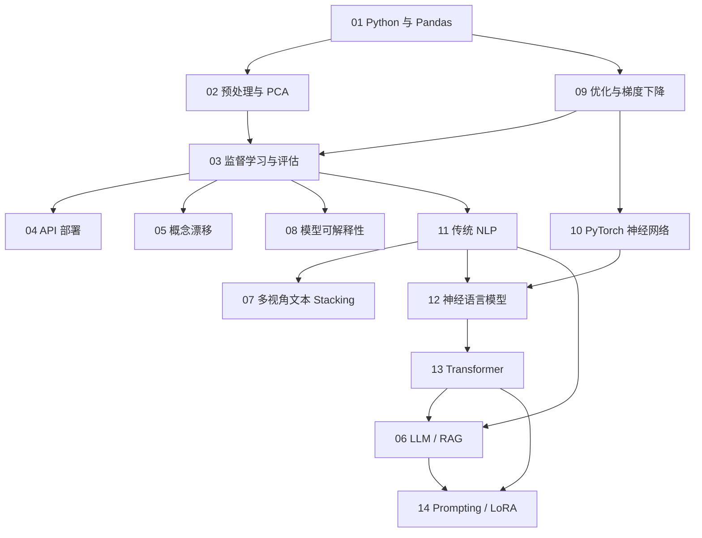

**语言：** [English](STUDY_ROADMAP.md) | 简体中文

# AI 知识库｜学习路线

建议先阅读 `notes/` 对应章节，再运行 `projects/`，最后尝试用自己的数据重做一次。

## 基础阶段：结构化数据与监督学习

| 章节 | 重点 | 练习项目 |
|---|---|---|
| 01 | Python、NumPy、Pandas、数据检查 | `01_data_foundations` |
| 02 | 标准化、编码、缺失值、PCA、Pipeline | `01_data_foundations` |
| 09 | 最小二乘、Ridge、GD | `09_regression_and_optimization` |
| 03 | 回归、分类、CV、MAE/F1 | `02_house_price_regression`, `03_classification_and_faces` |
| 04 | 训练 → 保存 → REST 服务 → 推理 | `04_flask_iris_api` |
| 05 | Online Learning、Page–Hinkley | `05_concept_drift` |
| 08 | SHAP 全局/局部解释 | `08_explainable_ai` |

## 深度学习与 NLP

| 章节 | 重点 | 练习项目 |
|---|---|---|
| 10 | autograd、损失、优化器、训练循环 | `10_pytorch_mlp` |
| 11 | BoW、TF-IDF、Embedding、N-gram | `11_classical_nlp` |
| 07 | Base / Meta / Test Stacking | `07_multiview_stacking` |
| 12 | Neural N-gram、LSTM、生成 | `12_neural_language_models` |
| 13 | Q/K/V、Mask、Encoder | `13_transformer_encoder` |

## 生成式 AI 与工程实践

| 章节 | 重点 | 练习项目 |
|---|---|---|
| 06 | Prompt、检索、RAG、工具调用 | `06_llm_rag` |
| 14 | Zero/Few-shot、LoRA、PEFT | `14_llm_prompting_and_lora` |

**三条跨章节路线**：结构化数据（01→02→09→03→08→04）；文本分析（11→07→10→13）；生成式模型（11→12→13→06→14）。

Neural N-gram 可直接离线运行；LSTM 推理需要自行补充兼容词表与权重，见 [ASSETS.md](projects/12_neural_language_models/ASSETS.md)。所有项目默认使用已提供或生成的演示数据，不应把合成小样本指标当作真实性能。
