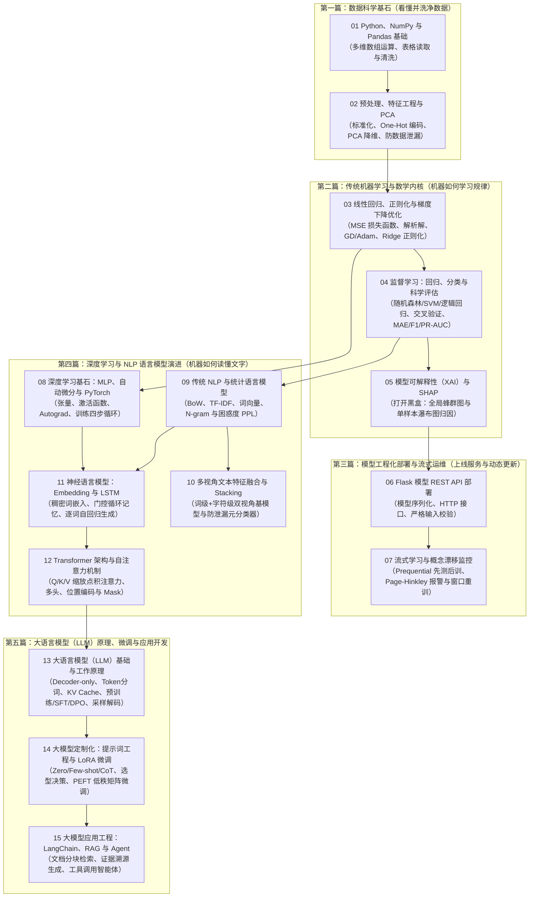

**语言：** [English](STUDY_ROADMAP.md) | 简体中文 · [首页](README.zh-CN.md)

# AI 知识库｜零基础全景学习路线与知识脉络（五篇十五章）

本知识库参考了 GitHub 上评分最高的开源 AI 课程体系（Microsoft、Datawhale、李沐《动手学深度学习》D2L、Karpathy `nn-zero-to-hero`、Maxime Labonne `llm-course`、Goku Mohandas `Made-With-ML`），将全部笔记严格按照**从零基础到现代大语言模型（LLM）应用工程的演进顺序**整理为 **「五大篇章、15 章循序渐进讲义（`notes/01` → `notes/15`）」**。

每一章都精准回答：**“上一章的技术留下了什么解决不了的痛点？本章的新概念到底有什么用？在现实生活中相当于什么？”**

---

## 一、 宏观心智模型：把学习 AI 比作「从学切菜到打造米其林智能厨房」

在看任何公式和代码前，先用这 5 个篇章的故事主线建立全局地图：

1. **第一篇：数据科学基石（`01 → 02`｜买菜、挑拣与净菜加工）**
   - 现实世界的数据充满缺失值、异常值和量纲差异（比如把“上千平米的面积”和“两三间卧室”直接混算）。
   - **作用**：先用 Python、NumPy 矩阵和 Pandas 把杂乱表格读进内存检查清洗（`01`），再通过标准化缩放、One-Hot 编码和 PCA 降维把原始数据加工成干净的特征矩阵，并严防“数据泄漏”（`02`）。
2. **第二篇：传统机器学习与数学内核（`03 → 04 → 05`｜学厨艺原理、模拟考评与拍 X 光片审计）**
   - 机器到底是怎么“从数据里总结出规律”的？
   - **作用**：先吃透所有 AI 模型的共同数学引擎——**损失函数、梯度下降优化与正则化**（`03`，就像蒙眼下山找最低谷）；再掌握回归与分类两大核心算法家族及交叉验证、F1/PR-AUC 防作弊评估（`04`）；最后用 **SHAP 可解释性**（`05`）拆解黑盒模型，算清每个特征对预测结果到底加了多少分、减了多少分。
3. **第三篇：模型工程化部署与流式运维（`06 → 07`｜开外卖窗口与应对顾客口味变化）**
   - 模型在本地脚本里跑通不算完，必须部署上线并长期维护。
   - **作用**：用 **Flask REST API** 把模型封装成 HTTP 接口对外提供实时预测（`06`）；当上线半年后外部环境改变（**概念漂移 Concept Drift**）导致模型变笨时，用 **Page–Hinkley 检测器**实时报警并触发滑动窗口重训（`07`）。
4. **第四篇：深度学习与自然语言处理演进（`08 → 09 → 10 → 11 → 12`｜机器如何一步步读懂人类文字）**
   - 传统机器学习擅长处理表格，但面对复杂非线性模式和人类语言就力不从心了。本篇带你亲历 **AI 读懂语言的四次技术飞跃**：
   - **飞跃 1（神经网络底座 `08`）**：用多层感知机（MLP）、非线性激活函数与 PyTorch 自动求导拟合复杂非线性规律。
   - **飞跃 2（统计词频与多视角集成 `09 → 10`）**：最早计算机靠数词频（BoW、TF-IDF、统计 N-gram，`09`）把文字变数字，并结合正文与元数据的多视角特征做 **Stacking 堆叠集成**（`10`）。
   - **飞跃 3（词嵌入与序列记忆 `11`）**：数词频会丢失语序且遇到新词组合概率归零。于是诞生了用稠密词向量（`Embedding`）和循环记忆状态（`LSTM`）逐词阅读并生成文本的**神经语言模型**（`11`）。
   - **飞跃 4（自注意力革命 `12`）**：LSTM 只能一个词一个词排队传话，算得慢且长文容易忘掉开头。**Transformer 与 Self-Attention（`12`）** 让全句任意两个词通过 `Q/K/V` 直接并行对话——**彻底奠定了现代所有大模型的基石！**
5. **第五篇：大语言模型（LLM）原理、微调与应用开发（`13 → 14 → 15`｜从读懂大模型内核到打造专属 RAG 与智能体）**
   - 为什么把 Transformer 放大就成了 ChatGPT / Qwen / DeepSeek？我们又该如何改造和应用它？
   - **第 13 章（大模型基础内核）**：讲透为什么 **Decoder-only（因果自回归预测下一个 Token）** 一统江湖，什么是 BPE 子词分词与 KV Cache，大模型诞生的 **预训练（Pre-training）→ 指令微调（SFT）→ 偏好对齐（RLHF/DPO）** 三阶段，以及 `Temperature / Top-p` 采样旋钮与“幻觉”成因。
   - **第 14 章（提示工程与 LoRA 微调）**：当需要定制大模型时，先用 **Zero/Few-shot 与思维链提示词（Prompting）** 零成本引导；若需改变模型固有说话风格或领域规约，则使用 **PEFT / LoRA 低秩微调**，冻结原模型、仅训练 <1% 的外挂适配器参数（$\Delta W = BA$）。
   - **第 15 章（LangChain、RAG 与 Agent 压轴实战）**：为解决大模型“不知道企业私有/最新文档”和“幻觉”痛点，用 **RAG（检索增强生成）** 给它配上“开卷参考书”；为解决大模型“只会动嘴不会动手”痛点，用 **Tool Calling 与 Agent（智能体）** 给它配上调用外部 API 的“手和脚”！

---

## 二、 五篇十五章全景演进图（按 `01 → 15` 顺序循序渐进）

---

## 三、 15 章「痛点演进与核心作用」全景对照表

| 章节与笔记入口 | 生活化直觉比喻 | 核心作用：它到底解决什么痛点？ | 如果跳过/乱用会踩什么坑？ | 配套代码项目 |
|---|---|---|---|---|
| **[01 Python、NumPy 与 Pandas](notes/01_python_pandas.zh-CN.md)** | 采购食材、高速切片机与分拣台 | 把散乱 CSV 读入内存，掌握 NumPy 矩阵乘法 `@` 与 Pandas 缺失值/异常值诊断。 | 不懂矩阵形状 `(N, D)`，或直接把含空值/乱码的数据喂给模型导致崩溃。 | [`01_data_foundations`](projects/01_data_foundations/README.zh-CN.md) |
| **[02 预处理、特征工程与 PCA](notes/02_preprocessing_feature_engineering_pca.zh-CN.md)** | 净菜加工与浓缩提取 | 统一特征量纲（标准化）、将文字类别转成数字（One-Hot）、用 PCA 压缩冗余维度。 | **数据泄漏（Data Leakage）**：在切分训练/测试集前对全量数据做标准化，导致评估分数虚高。 | [`01_data_foundations`](projects/01_data_foundations/README.zh-CN.md) |
| **[03 线性回归、正则化与梯度下降](notes/03_regression_optimization.zh-CN.md)** | 蒙眼下山找最低谷 | 揭示一切 AI 训练的底层引擎：用损失函数算误差，顺着梯度一步步修正参数，用 Ridge 防止过拟合。 | 遇到 Loss 变成 `NaN`（学习率过大）或收敛极慢（未做特征标准化）时不知道如何排查。 | [`09_regression_and_optimization`](projects/09_regression_and_optimization/README.zh-CN.md) |
| **[04 监督学习与评估体系](notes/04_supervised_learning_evaluation.zh-CN.md)** | 平时模拟考 vs 高考 | 掌握回归与分类主流算法，用交叉验证（CV）和科学指标（MAE、F1、PR-AUC）衡量真实泛化力。 | 在极度不平衡数据（99% 正常、1% 欺诈）上只看准确率（Accuracy），被“全猜正常”的废模型欺骗。 | [`02_house_price_regression`](projects/02_house_price_regression/README.zh-CN.md) [`03_classification_and_faces`](projects/03_classification_and_faces/README.zh-CN.md) |
| **[05 模型可解释性与 SHAP](notes/05_explainable_ai_shap.zh-CN.md)** | 给黑盒模型拍 X 光片 | 算出每个特征对单次预测推高或拉低了多少（Shapley 值），提供全局特征排序与单样本瀑布图归因。 | 在风控/医疗等场景只给黑盒结果却说不出理由，或把特征归因误认为现实因果效应。 | [`08_explainable_ai`](projects/08_explainable_ai/README.zh-CN.md) |
| **[06 Flask 模型 API 部署](notes/06_flask_model_deployment.zh-CN.md)** | 开设对外营业外卖窗口 | 将模型序列化保存，通过 HTTP REST API 接收请求、严格校验参数并实时返回预测 JSON。 | 在每次 HTTP 请求里重新训练模型，或者不对用户输入做校验导致非法数据打崩服务。 | [`04_flask_iris_api`](projects/04_flask_iris_api/README.zh-CN.md) |
| **[07 流式学习与概念漂移](notes/07_stream_learning_concept_drift.zh-CN.md)** | 发现顾客口味变了及时改菜单 | 当现实世界分布随时间变化（Concept Drift）导致模型衰退时，用 Page–Hinkley 实时报警并触发重训。 | 以为模型上线后就能一劳永逸，结果半年后外部环境大变，模型在线上静默失效。 | [`05_concept_drift`](projects/05_concept_drift/README.zh-CN.md) |
| **[08 神经网络与 PyTorch](notes/08_neural_networks_pytorch.zh-CN.md)** | 搭乐高积木组建深层大脑 | 从线性模型跃升到多层感知机（MLP），掌握激活函数、张量、Autograd 与 PyTorch 训练四步循环。 | 忘记 `zero_grad()` 导致梯度累加，或把已做过 Softmax 的概率传给 `CrossEntropyLoss`。 | [`10_pytorch_mlp`](projects/10_pytorch_mlp/README.zh-CN.md) |
| **[09 传统 NLP 与统计语言模型](notes/09_classical_nlp_language_models.zh-CN.md)** | 查字典数词频与词语接龙 | 用 BoW/TF-IDF/词向量将文本数字化，用统计 N-gram 预测下一词并用困惑度（PPL）给语言模型打分。 | 测试集遇到未见词（OOV）直接除零崩溃，或忽略语序导致无法区分“人咬狗”与“狗咬人”。 | [`11_classical_nlp`](projects/11_classical_nlp/README.zh-CN.md) |
| **[10 多视角文本 Stacking](notes/10_multiview_text_classification_stacking.zh-CN.md)** | 多学科专家会诊汇总投票 | 分别从“正文词级 TF-IDF”与“辅助字段字符 N-gram”训练基模型，再用元分类器无泄漏融合概率。 | 用基模型在自己训练集上的预测概率去训练元分类器，导致严重的元模型过拟合。 | [`07_multiview_stacking`](projects/07_multiview_stacking/README.zh-CN.md) |
| **[11 神经语言模型与 LSTM](notes/11_neural_language_models.zh-CN.md)** | 手捧笔记本按顺序读书 | 用 `nn.Embedding` 捕捉同义词相似性，用 LSTM 循环记忆状态 $(h_t, c_t)$ 记住前文并逐词生成句子。 | 推理生成时重复喂入整段历史；受限于串行排队计算，无法在超大规模语料上并行训练。 | [`12_neural_language_models`](projects/12_neural_language_models/ASSETS.zh-CN.md) |
| **[12 Transformer 与自注意力](notes/12_transformer_attention.zh-CN.md)** | 全员圆桌会议（任意词直接对话） | 抛弃慢速循环结构，通过 `Q/K/V` 缩放点积自注意力与位置编码，并行捕捉全句任意距离的词语关联。 | 漏掉 Padding Mask 导致空白填充符污染语义，或漏掉除以 $\sqrt{d_k}$ 导致 Softmax 梯度消失。 | [`13_transformer_encoder`](projects/13_transformer_encoder/README.zh-CN.md) |
| **[13 大语言模型 (LLM) 基础](notes/13_llm_foundations.zh-CN.md)** | 培养人类顶尖通才的三部曲 | 讲透 **Decoder-only 架构、BPE 分词、KV Cache、预训练→SFT→RLHF/DPO 三阶段与解码采样策略**。 | 分不清 Base 模型与 Instruct 模型，不懂 `Temperature/Top-p` 怎么调，不明白大模型为何会产生幻觉。 | [`13_transformer_encoder`](projects/13_transformer_encoder/README.zh-CN.md) [`14_llm_prompting_and_lora`](projects/14_llm_prompting_and_lora/README.zh-CN.md) |
| **[14 提示词工程与 LoRA 微调](notes/14_llm_prompting_finetuning_lora.zh-CN.md)** | 教沟通技巧与贴专属技能插件 | 掌握 Zero/Few-shot/CoT 提示词设计，明确何时选 Prompt/RAG/微调，并用 LoRA 低秩矩阵低成本微调。 | 把每天变动的业务文档拿去做微调（应该用 RAG），或以为 LoRA Adapter 脱离原基座模型能独立运行。 | [`14_llm_prompting_and_lora`](projects/14_llm_prompting_and_lora/README.zh-CN.md) |
| **[15 LangChain、RAG 与 Agent](notes/15_llm_langchain_rag.zh-CN.md)** | 给大模型配“开卷参考书”与“工具箱” | 用文档分块与检索（RAG）让大模型依据私有资料作答并标明出处；用 Agent 工具调用执行外部函数。 | 以为用了 RAG 就 100% 无幻觉；或不对外部检索文档做隔离，遭遇间接提示词注入攻击。 | [`06_llm_rag`](projects/06_llm_rag/README.zh-CN.md) |

---

## 四、 按目标定制的三条速通支线

- **📊 支线 A：数据科学与传统机器学习工程师（表格建模与 MLOps）**
  - **路径**：`01` → `02` → `03` → `04` → `05` → `06` → `07`
- **📝 支线 B：深度学习与 NLP 算法基础（从底层吃透语言模型演进）**
  - **路径**：`01` → `03` → `08` → `09` → `10` → `11` → `12` → `13`
- **🤖 支线 C：大模型（LLM）应用与微调工程师快车道（AIGC 实战）**
  - **路径**：`01` → `09（理解 TF-IDF 与词向量）` → `12（理解 Transformer 自注意力）` → `13（理解大模型原理与解码）` → `14（提示词与 LoRA 微调）` → `15（LangChain、RAG 与 Agent）`

---

## 五、 全网高分开源 AI 知识库精选与对标指南

当你在某个篇章想进一步深挖数学推导、观看配套视频或挑战大型工程时，推荐对照以下 **GitHub 高星标杆知识库**：

| 对应本库篇章 | 高星开源知识库 / 课程 | 出品方 / 作者 | 核心亮点与配合使用方式 |
|---|---|---|---|
| **第一、二篇** (`01–05`) | **[ML-For-Beginners](https://github.com/microsoft/ML-For-Beginners)** (80k+ ⭐) **[pumpkin-book（南瓜书）](https://github.com/datawhalechina/pumpkin-book)** (40k+ ⭐) | Microsoft / Datawhale | 微软手绘笔记与入门测验 + Datawhale 对《西瓜书》公式的保姆级推导；适合配合 `01–04` 夯实基础。 |
| **第三篇** (`06–07`) | **[Made-With-ML](https://github.com/GokuMohandas/Made-With-ML)** (40k+ ⭐) | Goku Mohandas | 工业界公认最佳 MLOps 指南；学完 `06–07` 后用它深入学习生产级 CI/CD、服务编排与全链路漂移监控。 |
| **第四篇** (`08–12`) | **[d2l-zh《动手学深度学习》](https://github.com/d2l-ai/d2l-zh)** (65k+ ⭐) **[nn-zero-to-hero](https://github.com/karpathy/nn-zero-to-hero)** | 李沐等 / Andrej Karpathy | 交互式 PyTorch 教材 + Karpathy 手把手敲出反向传播与 GPT；配合 `08–12` 打通深度学习底层任督二脉。 |
| **第五篇（原理与微调）** (`13–14`) | **[LLMs-from-scratch](https://github.com/rasbt/LLMs-from-scratch)** **[llm-course](https://github.com/mlabonne/llm-course)** & **[self-llm](https://github.com/datawhalechina/self-llm)** | Sebastian Raschka / Maxime Labonne / Datawhale | 从零手写 GPT + 大模型量化、LoRA/QLoRA 微调、DPO 对齐与国产开源模型本地部署实战宝典。 |
| **第五篇（RAG 与 Agent）** (`15`) | **[generative-ai-for-beginners](https://github.com/microsoft/generative-ai-for-beginners)** (75k+ ⭐) **[llm-universe](https://github.com/datawhalechina/llm-universe)** & **[hello-agents](https://github.com/datawhalechina/hello-agents)** | Microsoft / Datawhale | 微软 21 讲生成式 AI 课程 + Datawhale 个人知识库助手与智能体从零构建教程，直接作为第 `15` 章的进阶扩展。 |
