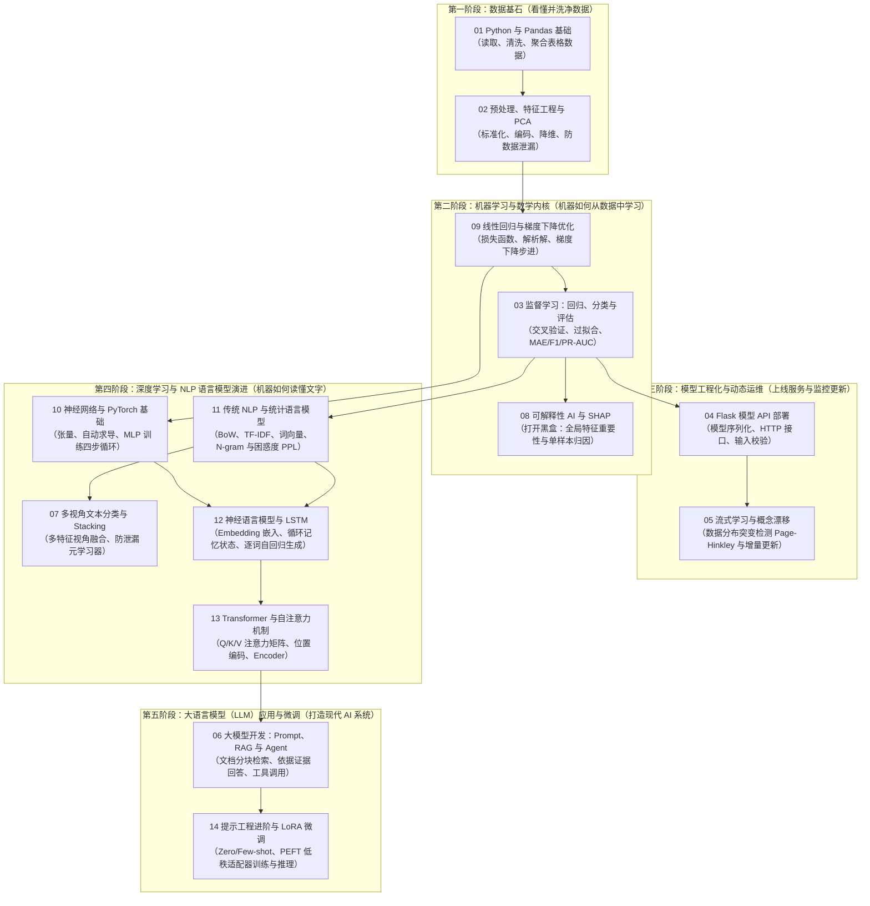

**语言：** [English](STUDY_ROADMAP.md) | 简体中文 · [首页](README.zh-CN.md)

# AI 知识库｜零基础全景学习路线与知识脉络

如果你是刚接触人工智能（AI）的新手，直接按编号 `01 → 14` 阅读往往会感到困惑：*“为什么刚学完分类（03）就突然跳到大模型 RAG（06），到了第 09 章却又退回去讲最基础的线性回归和梯度下降？”*

这是因为**章节编号 `01–14` 只是模块索引号**。为了让零基础读者真正看懂**“AI 是怎么一步步演进出来的”**以及**“每个知识点到底有什么用”**，我们参考了 GitHub 上评分最高的开源课程体系（Microsoft、Datawhale、李沐 D2L、Made With ML 等），将全部 14 个模块重构为 **「五阶递进式知识架构」**。

---

## 一、 宏观心智模型：把构建 AI 系统比作「培养并经营一家专业顾问餐厅」

在钻进数学公式和代码之前，先用一张全景图理解这 14 个模块在现实世界中各自扮演什么角色：

1. **第一阶段：数据基石（买菜与洗菜｜`01 → 02`）**
   - 巧妇难为无米之炊。现实中的数据充满缺失值、格式错误、量纲混乱（比如把“平方米”和“房间数”直接相加）。
   - **作用**：用 Python/Pandas 把杂乱数据读进来洗干净（`01`），再通过标准化、独热编码、PCA 降维把原始数据提炼成机器能消化的“净菜（特征）”（`02`）。
2. **第二阶段：传统机器学习与数学内核（学厨艺、内部试菜与写配方说明｜`09 → 03 → 08`）**
   - 机器到底是怎么“学习”规律的？
   - **作用**：先理解机器试错的核心引擎——**梯度下降与损失优化**（`09`，就像蒙着眼睛下山找最低谷）；再掌握预测连续数值（回归）和判断类别（分类）的标准流程与防作弊评估（`03`）；最后用 **SHAP 可解释性**（`08`）拆解黑盒模型，向业务方解释“模型为什么做出这个判断”。
3. **第三阶段：工程落地与持续维护（开门营业与适应季节变化｜`04 → 05`）**
   - 模型在你的电脑里跑通不算完，必须放到线上给真实用户调用，而且外部世界随时在变。
   - **作用**：用 **Flask REST API** 把训练好的模型包装成网络接口对外服务（`04`）；当市场环境或用户习惯发生突变（概念漂移）导致模型变笨时，用 **Page–Hinkley 检测与在线学习**（`05`）及时报警并让模型动态更新。
4. **第四阶段：从传统 NLP 到深度学习与 Transformer（从看数字表格，到读懂人类语言｜`10 → 11 → 07 → 12 → 13`）**
   - 传统机器学习擅长处理 Excel 表格，但面对复杂的非线性规律和人类自然语言（文章、评论、对话）就力不从心了。这一阶段展示了 **AI 读懂文字的四次技术大跃迁**：
   - **跃迁 1（神经网络底座 `10`）**：引入多层感知机（MLP）与 PyTorch 自动微分，让模型具备拟合复杂非线性规律的能力。
   - **跃迁 2（统计词频与多视角集成 `11 → 07`）**：最早计算机不懂语义，只能靠“数词频”（BoW、TF-IDF、统计 N-gram，`11`），并通过组合正文与元数据的多视角特征做 **Stacking 堆叠集成**（`07`）来提升分类效果。
   - **跃迁 3（序列记忆 `12`）**：数词频会丢失语序（“狗咬人”和“人咬狗”词频一样）。于是出现了将词变成稠密向量、并带有循环记忆能力的 **Neural N-gram 与 LSTM**（`12`），学会按顺序逐词阅读和生成文本。
   - **跃迁 4（全局自注意力革命 `13`）**：LSTM 只能一个词一个词排队算，句子一长就“忘了开头”。**Transformer 与 Self-Attention（自注意力机制，`13`）** 彻底解决了这个问题——让句子里的每个词都能直接和所有词并行对话。**这就是今天所有大语言模型（GPT、Claude、Qwen、DeepSeek）的核心基石。**
5. **第五阶段：大语言模型（LLM）应用与微调实战（站在巨人肩膀上打造专属智能体｜`06 → 14`）**
   - 有了基于 Transformer 预训练好的超强大模型，我们不再需要从零训练语言模型，而是聚焦于如何把它改造成解决实际业务问题的利器：
   - **作用**：大模型有两大痛点——“不知道你的私有/最新文档”且“容易一本正经地胡说八道（幻觉）”。通过 **Prompt 工程 + RAG（检索增强生成）+ Agent 工具调用**（`06`），相当于给大模型配上了“开卷考试参考书”和“计算器/API 手脚”；如果还需要改变它的回答风格、固定输出规约或注入垂直领域习惯，则使用 **PEFT / LoRA 参数高效微调**（`14`），花极小算力为大模型挂上专属“技能插件”。

---

## 二、 五阶递进全景路线图（推荐按此顺序学习）

建议先阅读 `notes/` 对应章节理解直觉与原理，再运行 `projects/` 中的代码观察输出，最后尝试替换为你自己的数据。

---

## 三、 14 个知识模块「痛点演进与作用」速查表

每一章都不是孤立存在的，而是为了解决上一个阶段留下的真实问题：

| 推荐学习顺序 | 章节与笔记入口 | 生活化直觉比喻 | 核心作用：它到底解决什么痛点？ | 如果跳过/乱用会踩什么坑？ | 配套实战项目 |
|---|---|---|---|---|---|
| **第 1 步** | [01 Python 与 Pandas](notes/01_python_pandas.zh-CN.md) | 食材采购与分拣员 | 把散乱的 CSV/表格读入内存，查清缺失值、异常值与数据类型，做分组统计。 | 连数据里有乱码、空值或极值都不知道，直接喂给模型导致报错或结果失真。 | [`01_data_foundations`](projects/01_data_foundations/README.zh-CN.md) |
| **第 2 步** | [02 预处理与 PCA](notes/02_preprocessing_feature_engineering_pca.zh-CN.md) | 净菜加工与浓缩提取 | 统一不同特征的量纲（标准化）、把文字类别转成数字（One-Hot）、用 PCA 压缩冗余维度。 | **数据泄漏（Data Leakage）**：在切分训练/测试集前对全量数据做标准化，导致评估分数虚高、上线崩盘。 | [`01_data_foundations`](projects/01_data_foundations/README.zh-CN.md) |
| **第 3 步** | [09 梯度下降与优化](notes/09_regression_optimization.zh-CN.md) | 蒙眼下山找最低谷 | 揭示一切机器学习与神经网络的底层动力：如何定义“预测错得有多离谱（损失函数）”，并顺着坡度（梯度）一步步修正参数。 | 调参全靠瞎猜；遇到 Loss 变成 `NaN`（梯度爆炸）或死活不收敛时不知道怎么排查学习率与特征尺度。 | [`09_regression_and_optimization`](projects/09_regression_and_optimization/README.zh-CN.md) |
| **第 4 步** | [03 监督学习与评估](notes/03_supervised_learning_evaluation.zh-CN.md) | 平时模拟考 vs 高考 | 建立回归（预测房价）和分类（识别数字/人脸）的标准流水线，用交叉验证（CV）和科学的指标（MAE、F1、PR-AUC）衡量真实能力。 | 在极度不平衡数据（如 99% 正常、1% 欺诈）上只看准确率（Accuracy），把一个“全猜正常”的废模型当成 99 分好模型。 | [`02_house_price_regression`](projects/02_house_price_regression/README.zh-CN.md) [`03_classification_and_faces`](projects/03_classification_and_faces/README.zh-CN.md) |
| **第 5 步** | [08 可解释性 AI (SHAP)](notes/08_explainable_ai_shap.zh-CN.md) | 给黑盒模型拍 X 光片 | 算出每个特征对最终预测结果推高或拉低了多少（Shapley 值），提供全局特征排序与单样本决策理由。 | 在医疗、金融风控等高风险场景只给一个预测结果却说不出理由，或者把特征相关性误认为因果关系。 | [`08_explainable_ai`](projects/08_explainable_ai/README.zh-CN.md) |
| **第 6 步** | [04 Flask 模型部署](notes/04_flask_model_deployment.zh-CN.md) | 把厨房搬进对外营业窗口 | 将训练好的模型保存为文件，通过 HTTP REST API 接收外部请求、校验参数并实时返回预测 JSON。 | 每次收到请求都重新训练模型，或者不对用户输入做校验导致非法数据直接打崩服务端。 | [`04_flask_iris_api`](projects/04_flask_iris_api/README.zh-CN.md) |
| **第 7 步** | [05 流式学习与概念漂移](notes/05_stream_learning_concept_drift.zh-CN.md) | 发现顾客口味变了及时改菜单 | 当真实世界随时间变化（Concept Drift）导致静态模型准确率下滑时，用 Page–Hinkley 算法实时监测报警并触发滑动窗口重训。 | 以为模型上线后就能一劳永逸，结果半年后外部环境大变，模型在线上静默失效造成业务损失。 | [`05_concept_drift`](projects/05_concept_drift/README.zh-CN.md) |
| **第 8 步** | [10 神经网络与 PyTorch](notes/10_neural_networks_pytorch.zh-CN.md) | 搭乐高积木组建深层大脑 | 从单层线性模型跃升到多层感知机（MLP），掌握激活函数、张量（Tensor）、自动求导与 PyTorch 训练四步法（前向、算损失、反向传播、更新）。 | 忘记 `zero_grad()` 导致梯度累加错误，或者把已经做过 Softmax 的概率传给 `CrossEntropyLoss`。 | [`10_pytorch_mlp`](projects/10_pytorch_mlp/README.zh-CN.md) |
| **第 9 步** | [11 传统 NLP 与语言模型](notes/11_classical_nlp_language_models.zh-CN.md) | 用词频字典统计文章特征 | 解决“计算机只认识数字不认识文字”的问题：用 BoW/TF-IDF 把文本变成向量，用 N-gram 预测下一个词并用困惑度（PPL）评估语言模型好坏。 | 遇到测试集中没见过的新词（OOV）直接出现零概率除零错误，或者对长文本词向量简单求平均导致丢失语序和否定词。 | [`11_classical_nlp`](projects/11_classical_nlp/README.zh-CN.md) |
| **第 10 步** | [07 多视角文本 Stacking](notes/07_multiview_text_classification_stacking.zh-CN.md) | 多个专家分别看不同线索再汇总投票 | 当单一文本特征不够全面时，分别从“正文词频”和“辅助字段字符特征”训练不同基模型，再用元模型（Meta-Classifier）融合预测概率。 | 用基模型已经见过的训练集预测概率去训练元模型，导致严重的过拟合与特征泄漏。 | [`07_multiview_stacking`](projects/07_multiview_stacking/README.zh-CN.md) |
| **第 11 步** | [12 神经语言模型与 LSTM](notes/12_neural_language_models.zh-CN.md) | 一边读书一边做笔记的记忆阅读器 | 告别死记硬背词频表，用 Embedding 词嵌入捕捉近义词，用 LSTM 循环隐藏状态（Hidden/Cell State）记住上下文并逐词生成新句子。 | 推理生成时重复喂入整段历史或搞混 `<unk>` 词表映射；不理解为什么循环结构无法在大规模语料上高效并行。 | [`12_neural_language_models`](projects/12_neural_language_models/ASSETS.zh-CN.md) |
| **第 12 步** | [13 Transformer 与自注意力](notes/13_transformer_attention.zh-CN.md) | 全员圆桌会议（任意两个词直接对话） | 取代慢速的循环网络，通过 `Q/K/V` 缩放点积自注意力与位置编码，并行捕捉任意距离的词语关联——现代大语言模型（LLM）的核心引擎。 | 漏掉 Padding Mask 导致模型把补齐的空白符当成有效信息，或者把注意力权重热图直接等同于因果解释。 | [`13_transformer_encoder`](projects/13_transformer_encoder/README.zh-CN.md) |
| **第 13 步** | [06 大模型、LangChain 与 RAG](notes/06_llm_langchain_rag.zh-CN.md) | 给聪明的大模型配“开卷参考书”与“工具箱” | 不重训模型，通过文档切块与检索（RAG）让大模型依据私有资料回答并附上引用；通过 Tool Calling / Agent 让大模型能调用外部工具。 | 以为用了 RAG 就 100% 不会产生幻觉；或者不对外部检索文档做隔离，遭遇提示词注入（Prompt Injection）攻击。 | [`06_llm_rag`](projects/06_llm_rag/README.zh-CN.md) |
| **第 14 步** | [14 提示工程与 LoRA 微调](notes/14_llm_prompting_finetuning_lora.zh-CN.md) | 先教说话技巧，再挂专属“技能扩展包” | 掌握何用 Prompting（Zero/Few-shot）、何时用 RAG、何时用微调；通过 LoRA 冻结基座模型，仅训练低秩矩阵 `ΔW = BA` 低成本定制大模型。 | 把“每天都在变动的公司规章”拿去做 LoRA 微调（应该用 RAG），或者以为几 MB 的 LoRA Adapter 权重脱离原基座模型也能独立运行。 | [`14_llm_prompting_and_lora`](projects/14_llm_prompting_and_lora/README.zh-CN.md) |

---

## 四、 按你的目标定制学习支线（三条最短路径）

如果你时间有限，不需要一次性学完 14 章，可以根据自己的目标选择一条主线：

1. **📊 路线 A：数据分析与传统机器学习工程师（结构化表格数据方向）**
   - **路径**：`01 数据基础` → `02 预处理与 PCA` → `09 梯度下降与优化` → `03 监督学习与评估` → `08 SHAP 可解释性` → `04 Flask API 部署` → `05 概念漂移监控`
   - **适合人群**：数据科学、风控建模、商业分析、传统算法岗入门。
2. **📝 路线 B：NLP 与深度学习算法基础（从底层理解语言模型）**
   - **路径**：`01 数据基础` → `09 梯度下降与优化` → `10 PyTorch 神经网络` → `11 传统 NLP` → `07 多视角 Stacking` → `12 神经语言模型与 LSTM` → `13 Transformer 与自注意力`
   - **适合人群**：希望打牢 PyTorch 与深度学习基本功，搞懂语言模型从 TF-IDF 到 Transformer 演进全过程的同学。
3. **🤖 路线 C：大模型（LLM）应用开发与微调实战（AIGC 工程师快车道）**
   - **路径**：`01 数据基础` → `11 传统 NLP（理解 TF-IDF 与词向量）` → `13 Transformer（理解注意力与 Token）` → `06 LLM / LangChain / RAG / Agent` → `14 Prompt 工程与 LoRA 微调`
   - **适合人群**：后端/全栈转 AI 应用开发、构建企业级知识库问答与智能体（Agent）、微调开源大模型的开发者。

---

## 五、 全网高分开源 AI 知识库精选与对标指南

本仓库旨在提供一套**轻量、离线可跑通、中英双语对照**的最小完备知识闭环。当你在某个阶段想要进一步深挖数学推导、观看视频讲解或挑战大型工业级项目时，强烈推荐搭配以下 **GitHub 高星（30k～100k+ Stars）顶级开源知识库**：

| 对应本库阶段 | 开源知识库 / 课程名称 | 出品方 / 作者 | 核心亮点与为什么值得看 | 推荐如何与本库配合使用 |
|---|---|---|---|---|
| **阶段 1 & 2** 机器学习基础 | **[ML-For-Beginners](https://github.com/microsoft/ML-For-Beginners)** (80k+ ⭐) | Microsoft (微软官方) | 手绘笔记 + 课后测验 + 循序渐进的 Scikit-learn 实战，专门面向零基础初学者设计。 | 学本库 `01、02、03、09` 时，若想看更多回归/分类案例，可对照阅读。 |
| **阶段 2** 数学推导进阶 | **[pumpkin-book（南瓜书）](https://github.com/datawhalechina/pumpkin-book)** (40k+ ⭐) | Datawhale 开源社区 | 对周志华《机器学习》（西瓜书）中所有跨度较大的数学公式进行了保姆级一步步推导。 | 学本库 `09`（最小二乘、岭回归、梯度推导）遇到数学卡点时查阅。 |
| **阶段 3** 工程化与 MLOps | **[Made-With-ML](https://github.com/GokuMohandas/Made-With-ML)** (40k+ ⭐) | Goku Mohandas | 工业界公认最好的 MLOps 教程，讲透如何把玩具模型变成包含测试、部署、漂移监控的生产系统。 | 学完本库 `04（API 部署）` 和 `05（概念漂移）` 后，用它了解企业级流水线标准。 |
| **阶段 4** 深度学习与 NLP | **[d2l-zh《动手学深度学习》](https://github.com/d2l-ai/d2l-zh)** (65k+ ⭐) | 李沐等 (阿玛逊/斯坦福) | 中文世界最好的深度学习交互式教材，每一章都有可运行的 PyTorch 代码与视频讲解。 | 学本库 `10（PyTorch MLP）、12（LSTM）、13（Transformer）` 时的最佳配套百科全书。 |
| **阶段 4** 从零手写神经网络 | **[nn-zero-to-hero](https://github.com/karpathy/nn-zero-to-hero)** & **[LLMs-from-scratch](https://github.com/rasbt/LLMs-from-scratch)** | Andrej Karpathy / Sebastian Raschka | 拒绝调包黑盒，带你用纯 Python/PyTorch 一行行手搓反向传播、分词器、多头注意力与 GPT 模型。 | 在跑通本库 `12` 和 `13` 的精简代码后，跟着敲一遍可彻底打通任督二脉。 |
| **阶段 5** 大模型应用与 RAG | **[generative-ai-for-beginners](https://github.com/microsoft/generative-ai-for-beginners)** & **[llm-universe](https://github.com/datawhalechina/llm-universe)** | Microsoft / Datawhale | 微软 21 讲生成式 AI 入门课 + Datawhale 手把手教你用 LangChain 和向量库搭建个人知识库助手。 | 学完本库 `06（LLM 与 RAG）` 后，参照它们将本地 TF-IDF 检索升级为完整向量数据库应用。 |
| **阶段 5** 大模型微调与全景 | **[llm-course](https://github.com/mlabonne/llm-course)** & **[self-llm](https://github.com/datawhalechina/self-llm)** | Maxime Labonne / Datawhale | 涵盖从 Transformer 原理、量化、LoRA/QLoRA 微调、DPO 对齐到开源模型（Qwen/Llama）本地部署全流程。 | 学完本库 `14（Prompt 与 LoRA）` 后，用 `self-llm` 在国产/主流开源大模型上做实战微调。 |

---

## 六、 运行说明与注意事项

- **离线优先**：除少数明确标注需要外部权重或云端 API 的扩展脚本外，绝大多数项目默认使用仓库内置或自动生成的演示数据，无需联网或付费即可跑通完整流程。
- **外部资产说明**：Neural N-gram 可直接离线运行；LSTM 推理需自行补充兼容词表与权重，详见 [ASSETS.zh-CN.md](projects/12_neural_language_models/ASSETS.zh-CN.md)。
- **科学评估原则**：所有项目默认使用小规模演示数据以保证秒级运行验证流程，切勿将合成小样本上的指标当作生产环境的真实性能。
